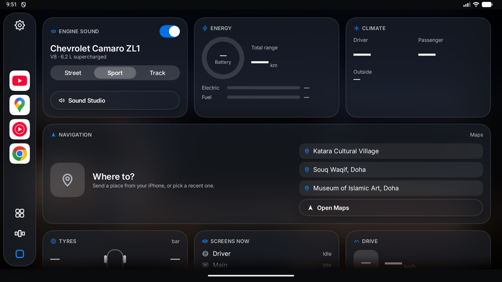
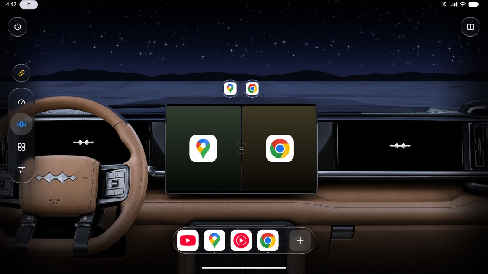

# Outo

A CarPlay-style cockpit app for the BYD Leopard 5 (Fang Cheng Bao Bao 5) head unit. It runs on the car's DiLink system (Android 13). It puts your apps where you want them: full screen or split in two on the main screen, or on the driver and passenger displays.





## What it does

- **Sidebar:** down the left side on every tab, as in CarPlay.
  - Your pinned apps: tap one to open it full screen on the main screen, zoomed in. From the Overview, Apps or Settings, the app grows out of its icon. Pin an app by holding it in Apps and dragging it onto the sidebar; drag one along the sidebar to move it, or hold it to remove it.
  - Under the pinned apps, after a thin line, one or two apps you used lately, as CarPlay's sidebar shows them. Hold one to keep it on the sidebar, or drag it in among the pinned ones.
  - Settings, Apps, Screens and the Overview's Home square at the bottom. The open one's icon turns blue.
  - Zoomed into a screen, it steps aside; two fingers up or the dots at the top bring it back.
  - When Outo isn't connected to the car, a red note at the top says so; tap it to connect.
- **Everywhere:** whatever you tap sinks a little and dims while your finger is on it, as on an iPhone, so you can see the tap landed even when an app takes a moment to answer.
- **Overview:**
  - A live map from the map app you used last, beside widgets you choose:
    - Now Playing, Engine Sound, Energy, Navigation;
    - Drive, Climate, Tyres, Screens now, Last 7 days.
  - Widgets look like Apple's: flat frosted cards, with the symbol and name in the accent colour. Until the car's values arrive, a widget says it's waiting rather than showing dashes.
  - The map works where it is: drag to move it, pinch to zoom, tap its buttons. Double-tap it to open it large.
  - Hold any widget, the map too, to move it, resize it or remove it. While the widgets shake, hold one for a moment before you drag it; a quick swipe scrolls the page instead.
  - When that map is on the driver cluster, the Overview takes it from there while it's open, all of it at the widget's size, and the cluster shows BYD's own view until you leave the Overview.
- **Screens:**
  - The car's three displays, drawn on a picture of the dashboard.
  - Drag apps from the sidebar onto a display, or split the main screen in two. You can swap the halves or drag the divider to resize them.
  - Zoom into an empty display and a shelf under the emblem offers the apps you used lately and your pinned ones, to open there with one tap, plus All Apps.
  - Close an app with its red button and "YouTube closed · Undo" shows for a few seconds; Undo opens it again where it was.
  - Tap a display to zoom in and use its apps; tap Screens on the sidebar, press the car's Back or swipe down with two fingers to zoom out. The controls hide after a few seconds; tap the dots at the top to bring them back.
  - Zoomed in, swipe two fingers left or right to move between the displays, the way pages turn. From the main screen, two fingers right open the driver cluster's map over it at full size, to pick a place, while the main screen's app keeps playing; two fingers left put the map back on the cluster.
  - When an app goes full screen on the main screen (a YouTube video, say), BYD's status bar and buttons step aside too; swipe in from the top or bottom edge to bring them back for a moment.
  - Save layouts, and choose what each display opens with at startup.
- **Apps:**
  - Every app in the car, with search, on pages of big icons that you swipe through, as in CarPlay, with the apps you used lately in a row above them.
  - Tap an app to open it full screen, zoomed in. Hold an icon to open it in a half, on another display, or in picture in picture, to pin it on the sidebar, or to make it show its phone or tablet layout.
- **Navigation:**
  - Reads the next turn from Waze or Google Maps for the Overview, the driver cluster and the head-up display.
  - On the driver cluster, Waze and Google Maps show only their map, without their own buttons and cards (**Settings › Driver Cluster › Map only**). The app runs on a hidden display wider than the cluster, and the cluster shows the part that is only map.
  - Places sent from an iPhone, over the car's Wi-Fi or the iPhone's hotspot, open in your map app.
- **Engine sound:** a synthesized engine that follows the car's pedal and speed. It comes with a garage of engine presets and a Sound Studio for tuning them.
- **Settings:** laid out like Apple's System Settings: one panel beside the sidebar, the pages on a card of their own with a search field (search any setting by name; each match says which page it's on), and each page's groups on cards raised off the panel. Light, dark or automatic appearance, accent colour and glass style; there are also pages for the screens and sidebar, the driver cluster, navigation, engine sound, startup, the car connection and integrations.

## How it works

Outo is an ordinary Android app with a small helper. The helper runs as Android's shell user, started over the car's ADB, and that lets it:

- host apps on hidden virtual displays, which Outo draws inside its own screens and passes your touches to;
- move apps between the car's displays;
- read the car's data, and send turns to the driver cluster and the head-up display.

Outo starts the helper itself through the car's network ADB (**Settings › Car Connection**). The first time, the car asks whether to allow debugging; tap **Always allow**. Until the helper is connected, Outo runs in preview mode.

The helper restarts itself when Outo is updated. If Outo closes, the helper keeps its displays and their apps for 90 seconds, so nothing is lost when Outo comes back.

## Requirements

- **The car:** a BYD Leopard 5 on DiLink 5.1 (Android 13), with network ADB on port 5555.
- **For development:** any Android 10+ device or emulator (`minSdk` 29). An emulator has no car data, so the car's values show as dashes.
- **To build:** JDK 17 (Android Studio's bundled one is fine) and Android SDK 36.

## Build

```bash
cd cockpit
./gradlew :app:assembleRelease
```

The APK lands in `cockpit/app/build/outputs/apk/release/app-release.apk`.

- **Use the release build in the car.** It starts and scrolls several times faster than the debug build.
- **Signing:** it's signed with the debug key, so it installs over earlier test builds.

Run the unit tests with:

```bash
./gradlew :app:testDebugUnitTest
```

## Install on the car

Get the APK from [Releases](https://github.com/ObadaMoe/Outo/releases) or build it. Then put the Mac and the car on the same network (an iPhone hotspot works) and run:

```bash
adb connect 172.20.10.3:5555
```

```bash
adb install -r Outo-0.5.0.apk
```

Use your car's own address in place of `172.20.10.3`. The first launch after an install takes a few seconds.

## Updates

From 0.5.0 on, Outo updates itself from this repository's releases, without a computer. With **Settings › About › Check for updates automatically** on, it looks for a newer release each time the car starts; **Check Now** looks straight away. A new version shows there, with a red dot on Settings; tap **Update** while parked. Outo downloads it, checks it's Outo, newer and signed with the same key, and the helper installs it; Outo closes and opens again by itself.

The first install of 0.5.0 still goes through `adb install`: older versions can't update themselves.

To publish a version, raise `versionName` and `versionCode` in `cockpit/app/build.gradle.kts`, commit and push, then run:

```bash
tools/release.sh "What changed"
```

Build releases on the same Mac as before: the car only installs an update signed with the same key as the Outo it has.

## Tools

| Script | What it does |
|---|---|
| `tools/find-car-adb.sh` | Looks for the car's ADB on the local network. Read-only. |
| `tools/probe-car.sh` | Takes a read-only inventory of the head unit into `car-probe/`, which is kept out of git. |
| `tools/start-helper.sh` | Starts the helper from a Mac, for when Outo can't reach ADB itself. |
| `tools/cluster-test.sh` | A step-by-step test of the driver cluster's map channel. |
| `tools/release.sh` | Builds the release APK and publishes it on GitHub, where the car finds it. |
| `cockpit/tools/night_background.py` | Draws the night versions of the dashboard backgrounds. |

## Project layout

All the code is in `cockpit/app/src/main/java/app/leopard/cockpit/`:

| Folder | What's in it |
|---|---|
| `ui/` | The Compose interface: `overview/`, `screens/`, `apps/`, `settings/`, `theme/` |
| `screens/` | The layout model, and the controller that places apps on displays |
| `car/` | Starting the helper over ADB, and talking to it |
| `helper/` | The helper process itself |
| `nav/` | Turn reading, the cluster and head-up display, and places from the phone |
| `media/` | Now Playing |
| `engine/` | The engine sound |
| `data/` | Settings, widgets, the app catalogue and the car's data |

## Status

Version 0.5.0 is the first that updates itself. Some things only the car can confirm:

- the pedal, speed and temperature readings;
- the engine sound and the outside speaker;
- cluster and head-up display turns;
- apps on the passenger screen;
- how the glass effects perform on the car's graphics chip.

The [releases](https://github.com/ObadaMoe/Outo/releases) list what changed in each version.
